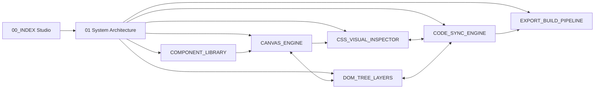

# 🎛️ Visual DOM & CSS Studio — Studio Workspace (UI Master Map)

> **Figma canvas UX + Pinegrow live HTML/CSS engine.** Setiap piksel yang digeser pengguna menghasilkan HTML5 & CSS3 yang valid, bersih, dan dapat dibaca manusia — tanpa format proprietary.

- **Arsitektur Engine:** [[01_SYSTEM_ARCHITECTURE|System Architecture & Engine Pipeline]]
- **Inventaris Fitur:** [[02_FEATURE_INVENTORY|Feature Inventory F001–F056]]
- **Alur End-to-End:** [[Workflows/DESIGN_TO_CODE_LIFECYCLE|Design → Code Lifecycle]] · [[Workflows/COLLABORATION_AND_RECOVERY|Collaboration & Crash Recovery]]

---

## 1. Peta Layout Studio (Klik Region untuk Membuka Spesifikasi)

```text
┌────────────────────────────────────────────────────────────────────────────────────────┐
│ MENU BAR  File  Edit  View  Insert  Element  Style  Code  Export  Help                 │
├────────────────────────────────────────────────────────────────────────────────────────┤
│ TOOLBAR  [V]Select [H]Hand [F]Frame [T]Text [I]Insert ▾ │ 🖥 1440 │ 📱 768 │ 📱 375 │ 100% ▾ │ ▶ Preview │ </> Code │ ⬇ Export │
├──────────────┬───────────────────────────────────────────────────────┬─────────────────┤
│ LEFT SIDEBAR │                 CANVAS CENTER                         │ RIGHT INSPECTOR │
│ ┌──────────┐ │   ┌─ Artboard: index.html @Desktop ─┐  ┌─ @Mobile ─┐  │ ┌─────────────┐ │
│ │ Pages    │ │   │  <iframe sandbox> live DOM      │  │ <iframe>   │  │ │ Selector    │ │
│ │ Layers   │ │   │  ▣ selection overlay (host)     │  │            │  │ │ .card:hover │ │
│ │ Insert   │ │   └─────────────────────────────────┘  └────────────┘  │ │ Box Model   │ │
│ │ Assets   │ │                                                       │ │ Layout      │ │
│ └──────────┘ │   rulers · smart guides · insertion indicator         │ │ Typography  │ │
│              │                                                       │ │ Classes/St. │ │
├──────────────┴───────────────────────────────────────────────────────┴─────────────────┤
│ BOTTOM PANEL  [ index.html | styles.css | app.js ]  Monaco Live Editor · Problems · Console │
└────────────────────────────────────────────────────────────────────────────────────────┘
```

| Region | Fungsi | Spesifikasi |
|---|---|---|
| **Toolbar → Select/Hand/Zoom** | Kamera kanvas, artboard, breakpoint | [[Modules/CANVAS_ENGINE/CANVAS-01_ZOOM_PAN\|Zoom, Pan & Artboards]] |
| **Canvas Center → Seleksi** | Hover, klik, marquee, resize handle | [[Modules/CANVAS_ENGINE/CANVAS-02_SELECTION_BOUNDS\|Selection & Bounds]] |
| **Canvas Center → Drag** | Reorder dalam flow, flex/grid, absolute | [[Modules/CANVAS_ENGINE/CANVAS-03_DRAG_DROP_REORDER\|Drag, Drop & Reorder]] |
| **Left Sidebar → Layers** | Hierarki DOM, lock, hide, rename | [[Modules/DOM_TREE_LAYERS/LAYER-01_TREE_REORDER\|Layers Tree]] |
| **Left Sidebar → Insert** | Primitives, blocks, web components | [[Modules/COMPONENT_LIBRARY/COMP-01_INSERTION_LOGIC\|Insertion Logic]] |
| **Left Sidebar → Assets** | Gambar, font, ikon SVG | [[Modules/COMPONENT_LIBRARY/COMP-01_INSERTION_LOGIC#Asset Manager Sub-Panel\|Asset Manager]] |
| **Right Inspector → Box Model** | Margin, padding, border, sizing | [[Modules/CSS_VISUAL_INSPECTOR/CSS-01_BOX_MODEL\|Box Model]] |
| **Right Inspector → Layout** | Flexbox & Grid visual controls | [[Modules/CSS_VISUAL_INSPECTOR/CSS-02_FLEXBOX_GRID\|Flexbox & Grid]] |
| **Right Inspector → Typography** | Font, unit, line-height, shadow | [[Modules/CSS_VISUAL_INSPECTOR/CSS-03_TYPOGRAPHY\|Typography]] |
| **Right Inspector → Selector Bar** | Class, pseudo-state, media query | [[Modules/CSS_VISUAL_INSPECTOR/CSS-04_CLASSES_STATES\|Classes & States]] |
| **Bottom Panel → Code** | Monaco two-way sync | [[Modules/CODE_SYNC_ENGINE/SYNC-01_AST_TO_CANVAS\|Monaco Live Editor]] |
| **Toolbar → Export** | Clean HTML/CSS, Tailwind, ZIP | [[Modules/EXPORT_BUILD_PIPELINE/EXP-01_PROJECT_EXPORT\|Project Export]] |

---

## 2. Menu Bar (Dropdown Navigation)

### File ▾
- New Project / Open Folder / Save (OPFS autosave) → [[01_SYSTEM_ARCHITECTURE#11. Project Storage & Autosave|Project Storage]]
- Import HTML/URL → [[Modules/CODE_SYNC_ENGINE/SYNC-01_AST_TO_CANVAS|Parse ke AST]]
- Export… → [[Modules/EXPORT_BUILD_PIPELINE/EXP-01_PROJECT_EXPORT|Export Pipeline]]

### Edit ▾
- Undo `Ctrl+Z` / Redo `Ctrl+Shift+Z` → [[01_SYSTEM_ARCHITECTURE#8. Undo Redo CRDT Command Layer|Undo/Redo CRDT]]
- Cut / Copy / Paste / Duplicate `Ctrl+D` → [[Modules/COMPONENT_LIBRARY/COMP-01_INSERTION_LOGIC|Insertion Logic (paste = insert)]]
- Select Parent `Shift+Enter` / Select Children `Enter` → [[Modules/CANVAS_ENGINE/CANVAS-02_SELECTION_BOUNDS|Selection]]

### View ▾
- Zoom In/Out/Fit/100% → [[Modules/CANVAS_ENGINE/CANVAS-01_ZOOM_PAN|Zoom & Pan]]
- Breakpoints (Desktop/Tablet/Mobile) → [[Modules/CANVAS_ENGINE/CANVAS-01_ZOOM_PAN|Artboards & Breakpoints]]
- Toggle Box-Model Overlay / Rulers / Guides → [[Modules/CANVAS_ENGINE/CANVAS-02_SELECTION_BOUNDS|Overlay]]

### Insert ▾
- HTML Primitives / Blocks / Web Components → [[Modules/COMPONENT_LIBRARY/_INDEX|Component Library]]

### Element ▾
- Wrap in `<div>` `Ctrl+G` / Unwrap `Ctrl+Shift+G` / Rename / Lock / Hide → [[Modules/DOM_TREE_LAYERS/LAYER-01_TREE_REORDER|Layers Ops]]

### Style ▾
- Add Class / Edit Rule / Force State / Media Query → [[Modules/CSS_VISUAL_INSPECTOR/CSS-04_CLASSES_STATES|Classes & States]]
- Design Tokens (CSS Custom Properties) → [[Modules/CSS_VISUAL_INSPECTOR/CSS-04_CLASSES_STATES#Design Tokens Panel|Tokens]]

### Code ▾
- Toggle Code Panel ``Ctrl+` `` / Format Document `Shift+Alt+F` → [[Modules/CODE_SYNC_ENGINE/SYNC-01_AST_TO_CANVAS|Monaco Live Editor]]

### Export ▾
- Export ZIP / Export Tailwind / Copy HTML of Selection → [[Modules/EXPORT_BUILD_PIPELINE/EXP-01_PROJECT_EXPORT|Export]]

---

## 3. Module Map



| # | Modul | Index | Feature Specs |
|---|---|---|---|
| M1 | Canvas Engine | [[Modules/CANVAS_ENGINE/_INDEX\|CANVAS_ENGINE]] | [[Modules/CANVAS_ENGINE/CANVAS-01_ZOOM_PAN\|01]] · [[Modules/CANVAS_ENGINE/CANVAS-02_SELECTION_BOUNDS\|02]] · [[Modules/CANVAS_ENGINE/CANVAS-03_DRAG_DROP_REORDER\|03]] · [[Modules/CANVAS_ENGINE/CANVAS-04_ARTBOARDS_GUIDES\|04]] |
| M2 | DOM Tree Layers | [[Modules/DOM_TREE_LAYERS/_INDEX\|DOM_TREE_LAYERS]] | [[Modules/DOM_TREE_LAYERS/LAYER-01_TREE_REORDER\|01]] · [[Modules/DOM_TREE_LAYERS/LAYER-02_STRUCTURAL_OPS\|02]] |
| M3 | CSS Visual Inspector | [[Modules/CSS_VISUAL_INSPECTOR/_INDEX\|CSS_VISUAL_INSPECTOR]] | [[Modules/CSS_VISUAL_INSPECTOR/CSS-01_BOX_MODEL\|01]] · [[Modules/CSS_VISUAL_INSPECTOR/CSS-02_FLEXBOX_GRID\|02]] · [[Modules/CSS_VISUAL_INSPECTOR/CSS-03_TYPOGRAPHY\|03]] · [[Modules/CSS_VISUAL_INSPECTOR/CSS-04_CLASSES_STATES\|04]] · [[Modules/CSS_VISUAL_INSPECTOR/CSS-05_BACKGROUNDS_EFFECTS\|05]] |
| M4 | Component Library | [[Modules/COMPONENT_LIBRARY/_INDEX\|COMPONENT_LIBRARY]] | [[Modules/COMPONENT_LIBRARY/COMP-01_INSERTION_LOGIC\|01]] · [[Modules/COMPONENT_LIBRARY/COMP-02_ASSET_MANAGER\|02]] |
| M5 | Code Sync Engine | [[Modules/CODE_SYNC_ENGINE/_INDEX\|CODE_SYNC_ENGINE]] | [[Modules/CODE_SYNC_ENGINE/SYNC-01_AST_TO_CANVAS\|01]] · [[Modules/CODE_SYNC_ENGINE/SYNC-02_FORMAT_DIAGNOSTICS\|02]] |
| M6 | Export Build Pipeline | [[Modules/EXPORT_BUILD_PIPELINE/_INDEX\|EXPORT_BUILD_PIPELINE]] | [[Modules/EXPORT_BUILD_PIPELINE/EXP-01_PROJECT_EXPORT\|01]] · [[Modules/EXPORT_BUILD_PIPELINE/EXP-02_TAILWIND_VALIDATION\|02]] |

---

## 4. Global Keyboard Map

| Shortcut | Aksi | Spesifikasi |
|---|---|---|
| `V` / `H` / `Space`+drag | Select / Hand / Pan sementara | [[Modules/CANVAS_ENGINE/CANVAS-01_ZOOM_PAN\|Zoom & Pan]] |
| `Ctrl`+wheel, `Ctrl+0`, `Shift+1`, `Shift+2` | Zoom, 100%, Fit all, Fit selection | [[Modules/CANVAS_ENGINE/CANVAS-01_ZOOM_PAN\|Zoom & Pan]] |
| `Click`, `Shift+Click`, `Ctrl+Click`, `Esc` | Select, multi, deep-select, select parent | [[Modules/CANVAS_ENGINE/CANVAS-02_SELECTION_BOUNDS\|Selection]] |
| `Alt` (hover) | Ukur jarak antar elemen | [[Modules/CANVAS_ENGINE/CANVAS-02_SELECTION_BOUNDS\|Selection]] |
| `Alt+↑/↓` | Pindah elemen ke sibling sebelumnya/berikutnya | [[Modules/CANVAS_ENGINE/CANVAS-03_DRAG_DROP_REORDER\|Reorder]] |
| `Ctrl+G` / `Ctrl+Shift+G` | Wrap / Unwrap | [[Modules/DOM_TREE_LAYERS/LAYER-01_TREE_REORDER\|Layers]] |
| `Ctrl+Shift+H` / `Ctrl+Shift+L` | Hide / Lock | [[Modules/DOM_TREE_LAYERS/LAYER-01_TREE_REORDER\|Layers]] |
| ``Ctrl+` `` | Toggle Code Panel | [[Modules/CODE_SYNC_ENGINE/SYNC-01_AST_TO_CANVAS\|Monaco]] |
| `Ctrl+K` | Command Palette | [[01_SYSTEM_ARCHITECTURE#12. Command Bus & Command Palette\|Command Bus]] |
| `Ctrl+E` | Export | [[Modules/EXPORT_BUILD_PIPELINE/EXP-01_PROJECT_EXPORT\|Export]] |

---

## 5. Status Proyek

| Fase | Deliverable | Status |
|---|---|---|
| FASE 1 | `00_INDEX`, `01_SYSTEM_ARCHITECTURE` | [x] Completed |
| FASE 2 | [[02_FEATURE_INVENTORY\|Feature Inventory]] | [x] Completed |
| FASE 3 | Deep-dive 18 spesifikasi fitur + 2 workflow | [x] Completed (spec v1.0) |
