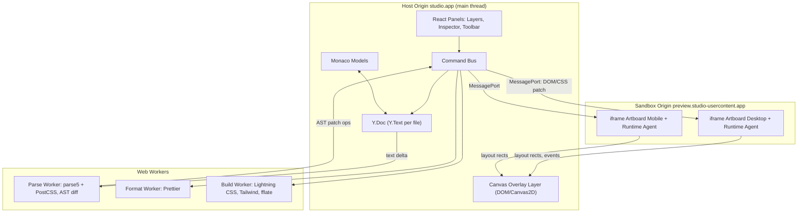
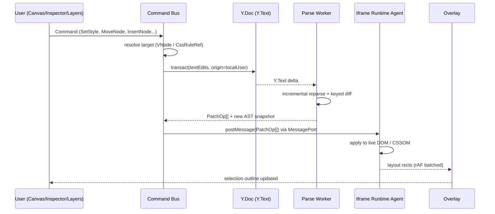

# 01 — System Architecture & Engine Pipeline

- **Navigasi Induk:** [[00_INDEX|Studio Workspace]] · [[02_FEATURE_INVENTORY|Feature Inventory]] · [[Workflows/DESIGN_TO_CODE_LIFECYCLE|Design → Code Lifecycle]]
- **Cakupan:** Tech stack, Document Model, Virtual DOM sync, CSS AST parser, Iframe communication pipeline, Hot-reloading state, Undo/Redo CRDT, keamanan, dan anggaran performa.

---

## 1. Prinsip Arsitektur

| # | Prinsip | Konsekuensi Teknis |
|---|---|---|
| P1 | **Source-first (Pinegrow model).** Teks HTML/CSS adalah *single source of truth*, bukan JSON proprietary. | Semua edit visual dikompilasi menjadi *text edits* minimal pada file sumber. Export = file sumber itu sendiri (dibersihkan). |
| P2 | **Live DOM, bukan simulasi.** Kanvas merender HTML asli di `<iframe>` browser engine. | Layout, cascade, flex/grid, font = 100% akurat browser. Tidak ada renderer kustom. |
| P3 | **Overlay di host, konten di iframe.** UI seleksi/handle digambar di dokumen host di atas iframe. | Overlay tidak pernah mencemari DOM pengguna; iframe bisa di-sandbox lintas origin. |
| P4 | **Transient vs Commit.** Interaksi kontinu (drag/scrub) tidak menyentuh AST sampai *pointerup*. | 60 FPS dijamin; satu gesture = satu entri undo. |
| P5 | **Formatting-preserving.** Edit visual tidak boleh memformat ulang kode pengguna. | Printer berbasis *source range splice*, bukan re-serialize seluruh AST. |
| P6 | **CRDT-native history.** Undo/redo dan (opsional) kolaborasi berjalan pada CRDT yang sama. | Yjs `Y.Text` per file + `Y.UndoManager` dengan origin per-user. |

---

## 2. Tech Stack

| Layer | Teknologi | Alasan |
|---|---|---|
| Shell App | **TypeScript 5.x**, **React 19** (UI panel), **Vite** | Ekosistem, HMR untuk pengembangan studio itu sendiri |
| Desktop wrapper (opsional) | **Tauri 2** | Akses filesystem native, bundle kecil |
| State UI | **Zustand** (UI ephemeral) + **Yjs** (dokumen persisten) | Pemisahan jelas: state dokumen ≠ state tampilan |
| HTML Parser | **parse5** (`sourceCodeLocationInfo: true`) | Spec-compliant WHATWG, memberi offset sumber per node/atribut |
| CSS Parser | **PostCSS** + `postcss-value-parser` + `postcss-selector-parser` | AST lossless (`raws` menyimpan whitespace), offset sumber |
| Specificity / Cascade | `@bramus/specificity`, kalkulasi cascade internal | Menampilkan asal nilai di Inspector |
| Code Editor | **Monaco Editor** (+ Emmet) | Multi-model, decorations, diagnostics |
| Formatter | **Prettier standalone** (HTML, CSS, Babel plugins) di Web Worker | Format on demand tanpa blokir UI |
| CSS Build | **Lightning CSS** (WASM) | Minify, prefix, nesting lowering, dedupe |
| Tailwind | **tailwindcss v4** `compile()` API di worker | JIT build dari kelas yang dipakai |
| Storage | **OPFS** (Origin Private File System) + `y-indexeddb` | Autosave lokal, offline-first |
| Kolaborasi (fase lanjut) | `y-websocket` / `y-webrtc` | CRDT sync tanpa ubah model data |
| Export | **fflate** (ZIP streaming), `sharp`-wasm / `@squoosh/lib` | ZIP & optimasi gambar di browser |
| Testing | Vitest, Playwright (visual regression kanvas) | Snapshot output HTML/CSS deterministik |

---

## 3. Topologi Runtime (Threads & Origins)



- **Main thread** hanya menangani input, overlay, dan React UI. Parsing berat dilakukan di **Parse Worker**.
- Setiap **artboard = satu iframe** (satu page × satu breakpoint). Iframe berada di **origin terpisah** (lihat [[#14. Security & Sandboxing Model]]).
- Di dalam setiap iframe disuntikkan **Runtime Agent** (`agent.js`, ±12 KB) yang menerima patch, mengukur layout, dan mem-forward event pointer.

---

## 4. Document Model — Source of Truth

```typescript
// Y.Doc root
interface ProjectDoc {
  files: Y.Map<Y.Text>;           // "index.html" -> Y.Text, "css/styles.css" -> Y.Text
  meta: Y.Map<FileMeta>;          // mime, encoding, lastFormattedHash
  designMeta: Y.Map<NodeDesignMeta>; // sidecar: layer names, lock, hide (TIDAK diekspor)
  assets: Y.Map<AssetRef>;        // hash -> { path, mime, size } (binary di OPFS)
  settings: Y.Map<unknown>;       // breakpoints, tokens, tailwind mode
}

interface NodeDesignMeta {
  nodeKey: string;        // stable key (lihat §5)
  layerName?: string;     // custom label di Layers panel
  locked?: boolean;
  hiddenInDesign?: boolean;
}
```

> [!IMPORTANT]
> Metadata desain (nama layer, lock, hide) **tidak pernah** ditulis ke HTML. Ia disimpan di `designMeta` (sidecar) dan dipetakan ke node melalui **Node Identity** (§5). Hasilnya: export selalu bersih.

---

## 5. HTML AST & Node Identity

### 5.1 Parsing
- `parse5.parse(text, { sourceCodeLocationInfo: true, onParseError })` dijalankan di Parse Worker.
- Setiap elemen membawa `sourceCodeLocation { startOffset, endOffset, startTag, endTag, attrs{} }`.
- Hasil dinormalisasi menjadi **VNode tree**:

```typescript
interface VNode {
  id: NodeId;                 // runtime id, contoh "n_8f3a"
  key: string;                // stable key untuk reconciliation & designMeta
  type: 'element' | 'text' | 'comment' | 'doctype';
  tag?: string;
  attrs: Array<{ name: string; value: string; range: Range }>;
  children: NodeId[];
  parent: NodeId | null;
  range: Range;               // [start, end) offset di file sumber
  startTagRange?: Range;
  endTagRange?: Range | null; // null = void / implied end tag
  file: string;
}
type Range = [number, number];
```

### 5.2 Node Identity & Reconciliation
- Runtime `id` diinjeksikan ke DOM iframe sebagai atribut `data-vds-id` **hanya pada salinan preview** (serializer preview), tidak pada `Y.Text`.
- Setelah reparse (karena edit kode), ID lama direkonsiliasi ke tree baru dengan algoritma **keyed tree diff**:
  1. Pasangkan node yang `range`-nya tidak tersentuh delta teks (offset digeser sesuai delta) → ID dipertahankan.
  2. Untuk subtree yang tersentuh: cocokkan berdasarkan `(tag, id attr, class list, index di parent)` dengan skor kemiripan ≥ 0.6.
  3. Sisa node = baru → ID baru; node lama tak berpasangan = dihapus (designMeta dipindah ke *orphan bin* 30 hari untuk undo).
- Kompleksitas: O(n) untuk area tak tersentuh, O(k²) hanya untuk subtree terdampak (k kecil).

---

## 6. CSS AST & CSSOM Mapping

- Setiap stylesheet (`<style>`, file `.css`, atribut `style=""`) di-parse PostCSS menjadi **RuleIndex**:

```typescript
interface CssRuleRef {
  ruleId: string;
  file: string;
  selector: string;             // ".card:hover"
  selectorRange: Range;
  media: string | null;         // "(max-width: 768px)"
  layer: string | null;         // @layer
  specificity: [number, number, number];
  order: number;                // urutan dokumen untuk tie-break cascade
  decls: Array<{ prop: string; value: string; important: boolean; range: Range; valueRange: Range }>;
}
```

- **Mapping ke CSSOM iframe:** setiap file CSS diwakili satu `CSSStyleSheet` *constructable* di iframe (`document.adoptedStyleSheets`). Patch CSS = `sheet.replaceSync(newText)` untuk perubahan struktural, atau `rule.style.setProperty()` untuk perubahan satu deklarasi (jalur cepat, indeks rule dipetakan dari `ruleId`).
- **Cascade Resolver** (di host, menggunakan data dari agent `getMatchedRules(nodeId)`) menentukan untuk tiap properti: nilai computed, rule pemenang, dan rule yang tertimpa → dipakai oleh [[Modules/CSS_VISUAL_INSPECTOR/CSS-04_CLASSES_STATES|Classes & States]].

---

## 7. Virtual DOM Sync Pipeline



**Arah sebaliknya (kode → kanvas):** Monaco mengubah `Y.Text` langsung (binding `y-monaco`) → alur sama mulai dari langkah "Y.Text delta". Detail lengkap: [[Modules/CODE_SYNC_ENGINE/SYNC-01_AST_TO_CANVAS|SYNC-01 AST ↔ Canvas]].

```typescript
type PatchOp =
  | { op: 'insert'; parentId: NodeId; beforeId: NodeId | null; html: string }
  | { op: 'remove'; id: NodeId }
  | { op: 'move'; id: NodeId; parentId: NodeId; beforeId: NodeId | null }
  | { op: 'setAttr'; id: NodeId; name: string; value: string | null }
  | { op: 'setText'; id: NodeId; text: string }
  | { op: 'replaceSheet'; file: string; cssText: string }
  | { op: 'setDecl'; file: string; ruleIndexPath: number[]; prop: string; value: string; important: boolean }
  | { op: 'reload'; reason: 'script-changed' | 'head-changed' | 'parse-recovery' };
```

---

## 8. Undo Redo CRDT Command Layer

- **Command Pattern di atas CRDT.** Setiap aksi pengguna adalah `Command` semantik yang dikompilasi menjadi *text edits* dan dijalankan dalam satu `ydoc.transact(fn, origin)`.
- **`Y.UndoManager`** dilacak pada `files` + `designMeta` dengan `trackedOrigins = { localUserOrigin }` → undo hanya membatalkan edit milik user lokal (aman untuk kolaborasi).
- **Grouping:** `captureTimeout: 400ms`; gesture kontinu diberi `stopCapturing()` di awal & akhir agar 1 drag = 1 undo step.
- **Selection restore:** `stack-item-added` menyimpan `{ selectionKeys, cameraState }` di `stackItem.meta`; saat undo/redo, seleksi & kamera dipulihkan.

```typescript
interface Command<P = unknown> {
  type: string;                       // "style.set", "node.move", "node.insert"
  payload: P;
  label: string;                      // ditampilkan di History panel: "Set padding 24px"
  compile(ctx: DocContext): TextEdit[];   // murni, deterministik
  canMerge?(prev: Command): boolean;      // gabung scrub berturut-turut
}
interface TextEdit { file: string; range: Range; insert: string }
```

> [!NOTE]
> Karena undo bekerja pada `Y.Text`, undo dari Inspector juga membalik perubahan yang terlihat di Monaco, dan sebaliknya — satu riwayat untuk semua view.

---

## 9. Iframe Communication Pipeline

1. Host membuat `<iframe sandbox="allow-scripts allow-forms" src="https://preview.studio-usercontent.app/boot?session=…">`.
2. Iframe boot memuat `agent.js` lalu mengirim `window.parent.postMessage({ t:'hello', v:PROTOCOL_VERSION }, HOST_ORIGIN)`.
3. Host membalas dengan `MessageChannel.port2` (transfer). Semua komunikasi berikutnya lewat **port khusus** (bukan `window.postMessage`) → tidak ada kebocoran ke listener pihak ketiga.
4. Host mengirim `{ t:'load', html, sheets[], assetsBaseUrl }`; agent menulis dokumen via `document.open()/write()` (sekali) lalu hanya menerima `PatchOp[]`.

```typescript
// Host -> Agent
type HostMsg =
  | { t: 'load'; html: string; sheets: Array<{ file: string; css: string }>; mode: 'design' | 'preview' }
  | { t: 'patch'; seq: number; ops: PatchOp[] }
  | { t: 'transient'; id: NodeId; style: Record<string, string> }   // jalur 60fps, lihat §13
  | { t: 'forceState'; id: NodeId; states: Array<':hover' | ':focus' | ':active' | ':focus-visible'> }
  | { t: 'measure'; ids: NodeId[] }
  | { t: 'hitTest'; x: number; y: number; deep: boolean };

// Agent -> Host
type AgentMsg =
  | { t: 'ack'; seq: number }
  | { t: 'rects'; frame: number; items: Array<{ id: NodeId; border: DOMRectInit; margin: Box; padding: Box }> }
  | { t: 'hit'; id: NodeId | null; path: NodeId[] }
  | { t: 'matchedRules'; id: NodeId; rules: Array<{ sheet: string; index: number[]; selector: string }> }
  | { t: 'error'; kind: 'script' | 'resource'; message: string; stack?: string };
interface Box { top: number; right: number; bottom: number; left: number }
```

- **Sequencing:** setiap `patch` punya `seq`; agent menerapkan berurutan dan meng-`ack`. Host tidak mengirim patch baru > 8 di depan ack (backpressure).
- **Layout feedback:** agent memakai `ResizeObserver` + `MutationObserver` + rAF untuk mengirim `rects` hanya untuk node yang terlihat/terseleksi.

---

## 10. Hot-Reloading State

| Jenis Perubahan | Strategi | State yang Dipertahankan |
|---|---|---|
| Deklarasi CSS tunggal | `setDecl` (CSSOM in-place) | Semua |
| Struktur CSS (rule baru, media) | `replaceSheet` via `replaceSync` | Semua |
| Atribut / teks / move / insert / remove | `PatchOp` DOM granular | JS state, scroll, form value, focus |
| `<head>` (meta, link eksternal) | `reload` lunak | Scroll per artboard, seleksi (via key) |
| `<script>` / file `.js` | `reload` penuh (hanya di mode *Preview*; mode *Design* skrip dinonaktifkan) | Scroll, seleksi, kamera, nilai form (serialisasi `form` → restore) |
| Parse error fatal | Tahan **last-good AST**, tidak ada patch | Semua; tampilkan diagnostik |

Snapshot sebelum reload: `{ scrollX, scrollY, selectionKeys, formValues: Record<key, string>, openDetails: key[] }` → dipulihkan setelah `load`.

---

## 11. Project Storage & Autosave

- Struktur proyek = folder file nyata (`index.html`, `about.html`, `css/`, `assets/`). Disimpan di **OPFS** (web) atau filesystem (Tauri).
- `Y.Doc` dipersist di IndexedDB (`y-indexeddb`) untuk riwayat; file teks ditulis ulang ke OPFS dengan **debounce 1 s** setelah transaksi terakhir.
- Konflik eksternal (file diubah editor lain, Tauri watcher): diff 3-arah (base = hash terakhir) → apply sebagai transaksi dengan origin `external` (tidak masuk undo stack lokal).

---

## 12. Command Bus & Command Palette

- Semua UI (menu, toolbar, shortcut, inspector, drag kanvas) hanya mengirim `Command` ke **Command Bus**; tidak ada panel yang menulis ke `Y.Doc` langsung.
- Command Bus: validasi (lock, content model HTML), compile → transact, publish event `command:applied` untuk telemetri & History panel.
- **Command Palette** (`Ctrl+K`) mengindeks seluruh command terdaftar + label + shortcut.

---

## 13. Transient Preview vs Commit (60 FPS Rule)

```text
pointerdown ──► UndoManager.stopCapturing()
pointermove ──► (rAF-throttled) HostMsg 'transient' → agent set inline style sementara
               (tidak menyentuh Y.Doc / AST / Monaco)
pointerup   ──► Command dikompilasi sekali → Y.transact → PatchOp final
               → agent menghapus transient style, menerapkan patch nyata
Esc saat drag ─► batalkan transient, tanpa Command
```

- Transient style ditulis ke `element.style` dengan prioritas `important` di *transient layer* agen dan dicatat agar bisa dibersihkan 100%.
- Inspector menampilkan nilai transient secara optimistik; Monaco diperbarui hanya saat commit.

---

## 14. Security & Sandboxing Model

- **Cross-origin isolation:** iframe di origin `*.studio-usercontent.app` (atau `blob:`/custom protocol Tauri dengan origin unik). **Tanpa** `allow-same-origin` + host origin berbeda → kode pengguna tidak bisa membaca `localStorage`/cookie/OPFS studio.
- **Mode Design:** CSP `script-src 'nonce-{agentNonce}'` → hanya agent yang berjalan; skrip pengguna non-aktif, event handler inline (`onclick`) tidak dieksekusi.
- **Mode Preview:** skrip pengguna aktif, tetap dalam sandbox; `allow-popups`, `allow-top-navigation`, `allow-modals` **tidak** diberikan.
- Validasi pesan: host memeriksa `event.origin === PREVIEW_ORIGIN` pada handshake; setelahnya hanya MessagePort. Payload divalidasi skema (zod) sebelum diproses.
- Import HTML dari URL: diambil lewat proxy server-side, `<script>` ditandai, `javascript:` URL & `srcdoc` bersarang ditolak pada export kecuali diizinkan eksplisit.

---

## 15. Performance Budgets

| Metrik | Target |
|---|---|
| Frame time saat pan/zoom/drag | ≤ 16.6 ms (60 FPS), p95 |
| Inspector scrub → visual update | ≤ 1 frame (jalur transient) |
| Commit → patch applied (dokumen 2.000 node) | ≤ 50 ms |
| Ketik di Monaco → kanvas update | debounce 150 ms + ≤ 50 ms reparse inkremental |
| Layers tree 10.000 node | virtualized, render ≤ 8 ms |
| Memori per artboard iframe idle | ≤ 40 MB; artboard di luar viewport dibekukan (lihat [[Modules/CANVAS_ENGINE/CANVAS-01_ZOOM_PAN\|CANVAS-01]]) |

---

## 16. Module Dependency Contracts

| Modul | Konsumsi | Menyediakan |
|---|---|---|
| [[Modules/CANVAS_ENGINE/_INDEX\|Canvas Engine]] | `rects`, `hit` dari agent | `selection`, `camera`, gesture commands |
| [[Modules/DOM_TREE_LAYERS/_INDEX\|DOM Tree Layers]] | VNode tree, designMeta | `node.move`, `node.rename`, `node.lock/hide` |
| [[Modules/CSS_VISUAL_INSPECTOR/_INDEX\|CSS Visual Inspector]] | RuleIndex, computed styles, cascade | `style.set`, `class.add`, `rule.create` |
| [[Modules/COMPONENT_LIBRARY/_INDEX\|Component Library]] | drop target dari Canvas | `node.insert`, asset refs |
| [[Modules/CODE_SYNC_ENGINE/_INDEX\|Code Sync Engine]] | Y.Text, Parse Worker | AST snapshot, PatchOp, diagnostics |
| [[Modules/EXPORT_BUILD_PIPELINE/_INDEX\|Export Pipeline]] | files, assets, settings | ZIP / folder build bersih |
