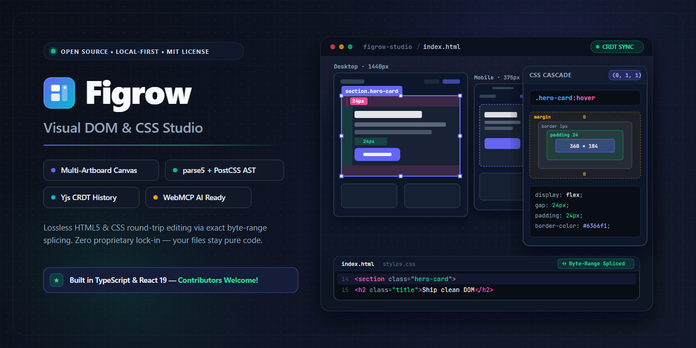
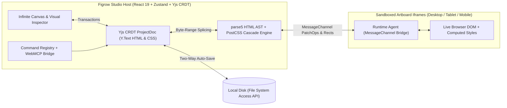

# Figrow — Visual DOM & CSS Studio

<div align="center">




**An open-source, local-first Visual DOM & CSS Studio combining a Figma-grade multi-artboard infinite canvas with a non-destructive HTML5 (`parse5`) + CSS (`postcss`) round-trip AST engine.**

[Features](#-key-features) • [Architecture](#-system-architecture) • [Quick Start](#-quick-start) • [Contribute](#-help-us-build-figrow-contributors-welcome) • [AI / WebMCP Bridge](#-ai--webmcp-agent-bridge) • [Documentation](#-architecture--module-specs)

</div>

---

## ✨ Why Figrow?

Most visual web builders force a trade-off:
- **Canvas design tools (Figma, Penpot)** give you an infinite multi-viewport canvas and tactile drag handles, but don't read or write real production HTML/CSS directly.
- **Traditional HTML builders (GrapesJS)** give you DOM blocks, but lock you into a single-iframe viewport and serialize over your original source code formatting.

**Figrow bridges both worlds:**
1. **Figma-Grade Multi-Artboard Infinite Canvas:** Pan (`Space+Drag`) and focal-point zoom (`0.1x`–`8.0x`) across synchronized **Desktop (`1440px`)**, **Tablet (`768px`)**, and **Mobile (`375px`)** live sandboxed artboards simultaneously.
2. **Lossless Source-Range AST Editing:** Powered by `parse5` (with `sourceCodeLocationInfo`), `postcss`, `@bramus/specificity`, and `postcss-selector-parser`. Editing a class, attribute, or CSS property patches only the exact byte range inside a **Yjs CRDT (`Y.Text`)** document—preserving your comments, scripts (`<script type="text/babel">`, Tailwind CDN, Lucide), and formatting.
3. **Local-First & Direct Disk Sync:** Open single `.html` files or entire multi-page project folders straight from your disk via the Chromium **File System Access API** with automatic two-way sync.

---

## 🚀 Key Features

| Category | Capabilities |
| :--- | :--- |
| **Infinite Canvas & Artboards** | Multi-viewport artboards (`Desktop`, `Tablet`, `Mobile`), rulers, smart alignment guides, `60fps` selection bounds, resize handles, and offscreen artboard lifecycle freezing. |
| **On-Canvas Direct Manipulation** | Drag-to-reorder Flex/Grid siblings with live drop indicators, on-canvas **Padding (`4` inner edges)** and **Flex/Grid Gap** drag handles, and **Inline Rich-Text Editing** (`Bold`, `Italic`, `Underline`, `Code`, `Link`). |
| **W3C CSS Cascade & Inspector** | Full W3C L4 specificity calculation (`@bramus/specificity` + `postcss-selector-parser`), state pills (`default`, `:hover`, `:focus`, `:active`, `:disabled`), media breakpoint routing (`all`, `≤1024px`, `≤768px`, `≤480px`), Box Model, Flexbox/Grid, Typography, Backgrounds, Filters, and CSS Variables (`var(--token)`). |
| **HTML Traits & Attributes** | Context-aware HTML attribute editor (`href`, `target`, `src`, `alt`, `loading`, `type`, `placeholder`, `name`, `required`, `disabled`, `aria-label`, plus custom `data-*` attributes). |
| **Universal Reusable Symbols** | Turn any DOM subtree (`Card`, `Pricing Tier`, `Footer`, `Navbar`) into a master component (`data-vds-symbol="<id>"`) and propagate changes across all HTML pages in your workspace. |
| **Bi-Directional Monaco Code Panel** | Integrated VS Code **Monaco Editor** (`Ctrl+J`) with live syntax diagnostics and one-click `Prettier` formatting. |
| **Command Palette & AI Bridge** | `Ctrl+K` Command Palette (`18+` studio commands) + automatic **W3C WebMCP (`navigator.modelContext`)** registration and `window.figrowCommands` API for autonomous AI coding agents. |

---

## 🏗️ System Architecture



---

## ⚡ Quick Start

### Prerequisites
- **Node.js** `>= 20.0.0`
- **npm** `>= 10.0.0` (or `pnpm` / `yarn`)
- A modern Chromium-based browser (Chrome, Edge, Brave, Arc) is recommended for native **File System Access API** folder synchronization.

### Installation & Development

```bash
# 1. Clone the repository
git clone https://github.com/<your-username>/figrow.git
cd figrow

# 2. Install dependencies
npm install

# 3. Start the Vite development server
npm run dev
```

Open **`http://localhost:5173`** in your browser.

### Running Tests & Production Build

```bash
# Run the full Vitest unit & integration test suite (47 tests across 9 suites)
npm test

# Typecheck and build the production bundle into ./dist
npm run build

# Preview the production build locally
npm run preview
```

---

## ⌨️ Keyboard Shortcuts

| Shortcut | Action |
| :--- | :--- |
| `Ctrl + K` / `Cmd + K` | Open **Command Palette** |
| `V` | Select / Move Tool |
| `H` / `Space + Drag` | Hand / Pan Canvas Tool |
| `Ctrl + Scroll` | Focal-Point Canvas Zoom (`10%` – `800%`) |
| `Double-Click` (on text) | Enter Inline Rich-Text Edit Mode |
| `Ctrl + G` | Group Selected Element (`<div class="vds-group">`) |
| `Ctrl + Shift + G` | Unwrap Selected Container |
| `Ctrl + D` | Duplicate Selected Element |
| `Delete` / `Backspace` | Delete Selected Element |
| `Ctrl + J` | Toggle Bottom **Monaco Code Editor** |
| `Ctrl + Z` / `Ctrl + Shift + Z` | Undo / Redo (Yjs CRDT Transaction History) |

---

## 🤖 AI & WebMCP Agent Bridge

Figrow exposes a programmatic command bus on `window.figrowCommands` and registers tools with **`navigator.modelContext` (WebMCP)** so browser-based AI agents can inspect and mutate the live studio:

```js
// Inspect current project state
window.figrowCommands.execute('ai.get.project.state');

// Insert a component from the catalog
window.figrowCommands.execute('ai.insert.component', {
  templateId: 'cmp_card',
  parentId: 'n_main'
});

// Mutate CSS properties through the W3C Cascade Engine
window.figrowCommands.execute('ai.update.element.style', {
  id: 'n_cta_top',
  property: 'background-color',
  value: '#10b981'
});

// Update HTML attributes & text content
window.figrowCommands.execute('ai.update.element.traits', {
  file: 'index.html',
  id: 'n_cta_top',
  textContent: 'Launch Studio',
  attributes: { 'aria-label': 'Launch Studio', 'data-track': 'cta' }
});
```

---

## 📂 Project Structure

```text
figrow/
├── src/
│   ├── components/
│   │   ├── canvas/        # InfiniteCanvas, ArtboardFrame, SelectionOverlay, Spacing/RichText spots
│   │   ├── code/          # MonacoBottomPanel (HTML/CSS live code editor)
│   │   ├── common/        # CommandPaletteModal (Ctrl+K)
│   │   ├── export/        # ExportModal (Vanilla ZIP & Tailwind converter)
│   │   ├── inspector/     # CssVisualInspector, Layout, Typography, Traits, Effects
│   │   ├── layers/        # Virtualized DOM Layers Tree & Multi-Page switcher
│   │   └── library/       # Component Catalog & Local Asset Manager
│   ├── engine/
│   │   ├── __tests__/     # Vitest unit & integration test suites
│   │   ├── ast/           # parse5 non-destructive HTML AST & W3C content model validator
│   │   ├── codeSync/      # Prettier formatting & syntax diagnostics
│   │   ├── commands/      # Command Registry & WebMCP AI Agent Bridge
│   │   ├── components/    # Component Catalog, Navbar Sync & Universal Symbol Sync Engine
│   │   ├── css/           # PostCSS Cascade Engine (@bramus/specificity + selector parser)
│   │   ├── doc/           # Yjs CRDT ProjectDoc & UndoManager
│   │   ├── export/        # ZIP bundler & CSS-to-Tailwind utility mapper
│   │   ├── fs/            # Chromium File System Access API disk sync & folder workspace
│   │   ├── import/        # Native-fidelity HTML/CSS importer
│   │   └── sandbox/       # MessageChannel iframe bridge & runtime agent
│   └── store/             # Zustand reactive stores (canvas, selection, layers, inspector, code)
├── Modules/               # Detailed engineering specifications per subsystem
├── Workflows/             # End-to-end design-to-code & collaboration lifecycle specs
├── 00_INDEX.md            # Master documentation index
├── 01_SYSTEM_ARCHITECTURE.md
└── 02_FEATURE_INVENTORY.md
```

---

## 📚 Architecture & Module Specs

- [`00_INDEX.md`](./00_INDEX.md) — Master Architecture & Specification Index
- [`01_SYSTEM_ARCHITECTURE.md`](./01_SYSTEM_ARCHITECTURE.md) — Core Engine, Sandbox Protocol & CRDT Data Flow
- [`02_FEATURE_INVENTORY.md`](./02_FEATURE_INVENTORY.md) — Complete Feature & Invariant Matrix
- [`Modules/`](./Modules) — Deep-dive specifications for Canvas, Layers, CSS Inspector, Code Sync, Components, and Export Pipeline

---

## 🤝 Help Us Build Figrow (Contributors Welcome!)

Most visual web editors either trap your work in a proprietary JSON schema or overwrite your hand-written HTML formatting on export. Figrow does neither. It edits real `.html` and `.css` files directly through exact byte-range AST splicing (`parse5` + `postcss` + `Y.Text`).

If you enjoy browser layout engines, AST tooling, CSS specifications, or tactile canvas UX, your PRs directly shape an open tool for web authors.

### Open Roadmap (`v1.1` & Beyond)

These are the next high-impact areas open for community PRs (tracked in [`02_FEATURE_INVENTORY.md`](./02_FEATURE_INVENTORY.md)):

- **Canvas & Layout:** Multi-artboard drag-across-pages (`F013`), custom CSS Grid track and area overlay handles on canvas (`F025`), and keyboard arrow nudging for absolute/fixed layers (`F014`).
- **CSS Inspector & Typography:** Interactive `clamp()` fluid typography visual preview (`F030`), multi-stop CSS gradient angle wheel on canvas, and container query (`@container`) breakpoint pills.
- **Component & Symbol System (`F038` / `F040`):** Slot and attribute overrides on reusable `data-vds-symbol` instances, plus live Shadow DOM custom element inspection.
- **Export & Build Pipeline (`F050` / `F051`):** Expanded Tailwind v4 utility mappings (`grid-cols-*`, `backdrop-blur-*`, CSS filters) and local WebP/AVIF responsive `srcset` generation.

### Where to Jump In

1. Browse open issues labeled `good first issue` or `help wanted`.
2. Read the relevant subsystem spec in [`Modules/`](./Modules) (for example, [`Modules/CSS_VISUAL_INSPECTOR`](./Modules/CSS_VISUAL_INSPECTOR) or [`Modules/EXPORT_BUILD_PIPELINE`](./Modules/EXPORT_BUILD_PIPELINE)) and check existing tests in `src/engine/__tests__/`.
3. Comment on an issue to claim it, read [`CONTRIBUTING.md`](./CONTRIBUTING.md), run `npm run dev` + `npm test`, and open a PR.

Every merged PR is credited in our release notes and on the repository's contributor wall.

---

## 📄 License

Distributed under the **MIT License**. See [`LICENSE`](./LICENSE) for full details.
