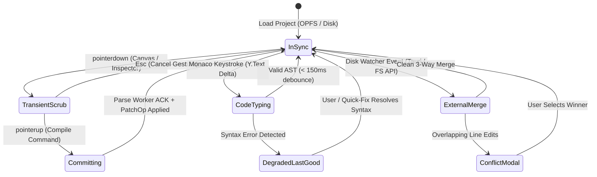

# Workflow: Real-Time Collaboration, Conflict Resolution & Crash Recovery

- **Navigasi Induk:** [[00_INDEX|Studio Workspace]] > [[01_SYSTEM_ARCHITECTURE|System Architecture]] · [[Workflows/DESIGN_TO_CODE_LIFECYCLE|Design → Code Lifecycle]]
- **Tujuan:** Mendefinisikan alur state machine saat terjadi pengeditan serentak (Visual vs Code, Multi-User CRDT, External File Watcher) serta pemulihan otomatis dari crash atau syntax error.

---

## 1. State Machine Sinkronisasi Dokumen

---

## 2. Skenario Operasional Kritis

### A. Skenario 1 — Visual Scrubbing vs Live Code View
1. Pengguna men-drag handle resize di `[[Modules/CANVAS_ENGINE/CANVAS-02_SELECTION_BOUNDS|CANVAS-02]]` atau menggeser slider di `[[Modules/CSS_VISUAL_INSPECTOR/CSS-01_BOX_MODEL|CSS-01]]`.
2. Selama `TransientScrub`, pesan `HostMsg.transient` dikirim ke iframe setiap frame (60 FPS). `Y.Text` dan `[[Modules/CODE_SYNC_ENGINE/SYNC-01_AST_TO_CANVAS|Monaco Live Editor]]` **tidak** disentuh.
3. Pada `pointerup` (`Committing`), satu `Command` dikompilasi menjadi `TextEdit` presisi pada rentang nilai CSS.
4. `Y.Doc` memancarkan delta → Monaco memperbarui hanya angka yang berubah → Parse Worker memvalidasi AST baru → Iframe membersihkan layer transien dan menerapkan `PatchOp.setDecl`.

### B. Skenario 2 — Syntax Error Recovery (`DegradedLastGood`)
1. Pengguna mengetik kode HTML/CSS di `[[Modules/CODE_SYNC_ENGINE/SYNC-01_AST_TO_CANVAS|SYNC-01]]` dan meninggalkan tag `
]`.
4. Begitu karakter `>` diketik atau tombol Quick-Fix diklik, state kembali ke `InSync` dan antrean mutasi diterapkan.

### C. Skenario 3 — Crash Recovery & Offline Persistence
1. Setiap transaksi `Y.Doc` langsung di-stream secara asinkron ke `IndexedDB` (`y-indexeddb`) dalam < 5 ms, dan di-flush sebagai berkas `.html`/`.css` murni ke **OPFS** setiap debounce 1 detik.
2. Jika tab browser tertutup paksa atau terjadi crash, saat aplikasi dibuka kembali (`[[01_SYSTEM_ARCHITECTURE#11. Project Storage & Autosave|Project Storage]]`), state `Y.Doc` direkonstruksi penuh beserta riwayat `Y.UndoManager` sehingga pengguna tetap dapat menekan `Ctrl+Z` untuk membatalkan aksi sebelum crash.
