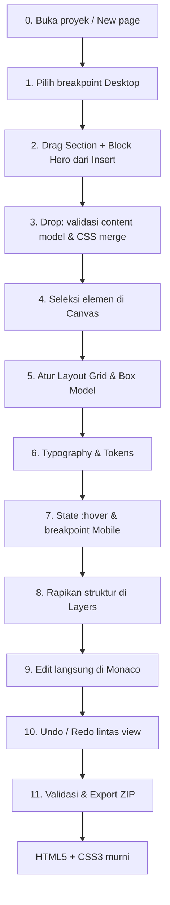

# Workflow: Design → Code Lifecycle

- **Navigasi Induk:** [[00_INDEX|Studio Workspace]] > [[01_SYSTEM_ARCHITECTURE|System Architecture]] · [[02_FEATURE_INVENTORY|Feature Inventory]]
- **Tujuan:** Menelusuri satu skenario utuh — dari drag elemen pertama hingga ZIP berisi HTML/CSS murni — dan menunjukkan modul/spesifikasi yang terlibat di setiap langkah.

---

## Peta Alur



---

## Langkah demi Langkah

### 0. Buka Proyek
- User membuka folder / membuat proyek baru → file disimpan di OPFS → `Y.Doc` dimuat. → [[01_SYSTEM_ARCHITECTURE#11. Project Storage & Autosave|Project Storage]]
- Artboard default `index.html @ Desktop 1440` dibuat; iframe sandbox melakukan handshake MessagePort. → [[01_SYSTEM_ARCHITECTURE#9. Iframe Communication Pipeline|Iframe Pipeline]]

### 1. Kamera & Breakpoint
- Zoom-to-fit, tambahkan artboard Mobile 375 di samping Desktop. → [[Modules/CANVAS_ENGINE/CANVAS-01_ZOOM_PAN|CANVAS-01]]

### 2–3. Insert & Drop
- Drag **Block Hero** dari tab Insert → drop slot dihitung agent → validasi `canContain` → bentrok `.hero` dicek → satu transaksi (HTML + CSS). → [[Modules/COMPONENT_LIBRARY/COMP-01_INSERTION_LOGIC|COMP-01]] · [[Modules/CANVAS_ENGINE/CANVAS-03_DRAG_DROP_REORDER|CANVAS-03]]
- **Kode yang dihasilkan:**
```html
<section class="hero">
  <h1 class="hero__title">Build faster</h1>
  <p class="hero__lead">Visual tools, real code.</p>
  <a class="btn btn--primary" href="#start">Get started</a>
</section>
```

### 4. Seleksi
- Klik `.hero` → outline biru + box-model tint → Layers reveal → Monaco reveal start tag. → [[Modules/CANVAS_ENGINE/CANVAS-02_SELECTION_BOUNDS|CANVAS-02]] · [[Modules/DOM_TREE_LAYERS/LAYER-01_TREE_REORDER|LAYER-01]]

### 5. Layout & Box Model
- Display `grid`, gap 24, padding 96/64 via scrub (transient 60 FPS → commit saat pointerup). → [[Modules/CSS_VISUAL_INSPECTOR/CSS-02_FLEXBOX_GRID|CSS-02]] · [[Modules/CSS_VISUAL_INSPECTOR/CSS-01_BOX_MODEL|CSS-01]] · [[01_SYSTEM_ARCHITECTURE#13. Transient Preview vs Commit (60 FPS Rule)|60 FPS Rule]]

### 6. Typography & Tokens
- Font Inter 600, ukuran fluid `clamp()`, warna bind ke `--text-1`. → [[Modules/CSS_VISUAL_INSPECTOR/CSS-03_TYPOGRAPHY|CSS-03]] · [[Modules/CSS_VISUAL_INSPECTOR/CSS-04_CLASSES_STATES#Design Tokens Panel|Tokens]]

### 7. States & Responsive
- Pilih `.btn--primary` → State `:hover` → ubah background. Klik `📱 ≤767` → padding hero 40/16. → [[Modules/CSS_VISUAL_INSPECTOR/CSS-04_CLASSES_STATES|CSS-04]]
- **CSS yang terkumpul sejauh ini:**
```css
:root { --text-1: #0f172a; --brand-500: #6366f1; --brand-600: #4f46e5; }
.hero { display: grid; gap: 24px; padding: 96px 64px; }
.hero__title {
  font-family: "Inter", system-ui, sans-serif;
  font-weight: 600;
  font-size: clamp(2rem, 1.2958rem + 3.0047vw, 4rem);
  color: var(--text-1);
}
.btn--primary { background-color: var(--brand-500); }
.btn--primary:hover { background-color: var(--brand-600); }
@media (max-width: 767.98px) {
  .hero { padding: 40px 16px; }
}
```

### 8. Struktur di Layers
- Wrap `h1 + p` (`Ctrl+G`), rename layer "Hero copy" (sidecar), lock background decor. → [[Modules/DOM_TREE_LAYERS/LAYER-01_TREE_REORDER|LAYER-01]]

### 9. Edit Kode Langsung
- Di Monaco user menambahkan `<span class="badge">New</span>` di dalam `h1` → reparse inkremental → kanvas update tanpa reload; typo sementara (`</spa`) → kanvas tetap last-good + diagnostic. → [[Modules/CODE_SYNC_ENGINE/SYNC-01_AST_TO_CANVAS|SYNC-01]]

### 10. Undo / Redo Lintas View
- `Ctrl+Z` tiga kali: membatalkan ketikan Monaco, lalu wrap, lalu rename — satu riwayat CRDT; seleksi & kamera dipulihkan. → [[01_SYSTEM_ARCHITECTURE#8. Undo Redo CRDT Command Layer|Undo/Redo CRDT]]

### 11. Validasi & Export
- `Ctrl+E` → validasi (alt text, link) → quick-fix → Export ZIP preset Production: HTML bersih, CSS diminify & di-prefix, gambar WebP + `srcset`, font self-host. → [[Modules/EXPORT_BUILD_PIPELINE/EXP-01_PROJECT_EXPORT|EXP-01]]

---

## Matriks Tanggung Jawab per Langkah

| Langkah | Canvas | Layers | Inspector | Library | Code Sync | Export | Arsitektur |
|---|:-:|:-:|:-:|:-:|:-:|:-:|:-:|
| 0 Buka | ● | | | | ● | | ● |
| 1 Breakpoint | ● | | ○ | | | | |
| 2–3 Insert | ● | ○ | | ● | ○ | | ● |
| 4 Seleksi | ● | ● | ● | | ○ | | |
| 5–7 Style | ○ | | ● | | ○ | | ● |
| 8 Struktur | ○ | ● | | | ○ | | |
| 9 Kode | ○ | ○ | ○ | | ● | | ● |
| 10 Undo | ○ | ○ | ○ | | ○ | | ● |
| 11 Export | | | | ○ | ○ | ● | |

● = pemilik utama · ○ = terdampak / sinkron

---

## Invarian End-to-End (Acceptance Criteria)

1. **Tidak ada format proprietary** — isi ZIP identik secara semantik dengan `Y.Text` setelah tahap clean/build. → [[Modules/EXPORT_BUILD_PIPELINE/EXP-01_PROJECT_EXPORT|EXP-01]]
2. **Diff minimal** — setiap edit visual hanya mengubah byte di range terdampak. → [[Modules/CODE_SYNC_ENGINE/SYNC-01_AST_TO_CANVAS|SYNC-01]]
3. **60 FPS** — semua gesture kontinu memakai jalur transient. → [[01_SYSTEM_ARCHITECTURE#15. Performance Budgets|Budgets]]
4. **Isolasi** — kode pengguna tidak pernah berjalan di origin studio. → [[01_SYSTEM_ARCHITECTURE#14. Security & Sandboxing Model|Security]]
5. **Satu riwayat** — undo konsisten di kanvas, inspector, layers, dan Monaco. → [[01_SYSTEM_ARCHITECTURE#8. Undo Redo CRDT Command Layer|CRDT]]
